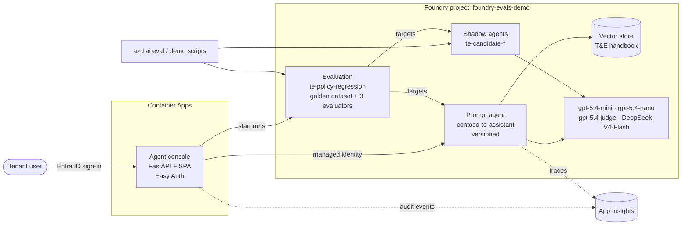

# Foundry Evals demo: the Contoso T&E Policy Assistant

A demo of **Microsoft Foundry evaluations** gating changes to an agent. It is shell-first (`azd ai agent`, `azd ai eval` and a few Python scripts), and it includes a web console behind **Entra ID sign-in** where anyone in the tenant can edit the agent and evaluate it.

Two stories, both told step by step in **[demo-flow.md](demo-flow.md)**:

1. **"Friendlier & shorter"**: a product owner makes a harmless-looking prompt edit in the console. Foundry evals show within minutes that the agent now approves things it can't and drops policy conditions. The gate fails, the fix ships, and the evals go green.
2. **"Can we run it cheaper?"**: a model bake-off compares the current gpt-5.4-mini with gpt-5.4-nano and the open-weights **DeepSeek-V4-Flash**. It measures quality, price per question and quality per $, prints a checklist of what must change to switch, and promotes, re-gates and rolls back the agent.

## Demo video

Watch the 3:37 demo: prompt regression and recovery, then the cheaper-model bake-off.

https://github.com/user-attachments/assets/53ecc70a-22f4-42e5-b765-417414e9686b

[Download the 2K video](demo-video-small.mp4?raw=true) (2560 x 1440, 66 MB).

## Architecture



- **Agent:** a Foundry prompt agent on gpt-5.4-mini that answers from the T&E handbook through `file_search`. Every change creates a new immutable agent version, with metadata recording who made it and why.
- **Evaluation** `te-policy-regression`: 30 golden questions (lookups, approvals, exceptions, out-of-scope questions, adversarial prompts), judged by gpt-5.4 with three evaluators:
  - `builtin.groundedness`;
  - `builtin.response_completeness`;
  - the custom rubric `te-policy-rubric` ([evals/policy-rubric.json](evals/policy-rubric.json)).
- **Gate:** the pass rate must be **≥ 90%**. Errored items count as failures.
- **Console:** sign-in is enforced by Container Apps authentication (Easy Auth) with a single-tenant app registration. The app reaches Foundry with a user-assigned managed identity that has the *Foundry User* role. Nobody needs keys: `disableLocalAuth` is on.
- **Tracing:** App Insights is connected to the project, so every agent call is traced with agent version, model, tokens and latency. The console also logs audit events (`agent_version_saved`, `eval_run_started`).

## Repository layout

| Path | What |
|---|---|
| [azure.yaml](azure.yaml) | azd project:<ul><li>the Foundry project and model deployments;</li><li>the agent's **v1 definition**, which is the reset baseline;</li><li>the eval service;</li><li>the console service.</li></ul> |
| [infra/](infra/) | Bicep: Foundry account and project, model deployments, App Insights, and the console (Container Apps, ACR, managed identity, Entra auth). |
| [agent/](agent/) | The handbook ([knowledge/contoso-te-policy.md](agent/knowledge/contoso-te-policy.md)), the three instruction presets for story 1 (v1 baseline, v2 friendlier & shorter, v3 friendly & safe), `setup_knowledge.py` (vector store) and `common.py` (shared helpers). |
| [evals/](evals/) | `azure.eval.yaml` (eval definition), `golden.jsonl` (dataset; regenerate with `build_golden.py`) and `policy-rubric.json` (custom rubric evaluator). |
| [console/](console/) | The agent console: FastAPI backend plus a static single-page app, and its Dockerfile. |
| [demo/](demo/) | Demo tooling:<ul><li>`model_bakeoff.py`: story 2;</li><li>`evalkit.py`: shared eval and agent helpers, also used by the console;</li><li>`pricing.py`: Azure Retail Prices API;</li><li>`reset.ps1` / `reset.py`;</li><li>`setup-entra.ps1`.</li></ul> |
| [connections/](connections/) | The App Insights connection of the Foundry project. |
| [hooks/](hooks/) | azd hooks. |
| [demo-flow.md](demo-flow.md) | The presenter guide: reset, prep, story 1, story 2, KQL and troubleshooting. |

## Prerequisites

- An Azure subscription with quota in **Sweden Central**:
  - gpt-5.4-mini, gpt-5.4 and gpt-5.4-nano as GlobalStandard, 300K TPM each;
  - DeepSeek-V4-Flash as DataZoneStandard, 200K TPM.
- Permission to create role assignments in the subscription, and to create an Entra **app registration** in the tenant.
- **azd ≥ 1.37** with the Foundry extensions:

  ```powershell
  azd extension install microsoft.foundry
  azd extension install azure.ai.evaluations
  ```

- **PowerShell 7** with the Az modules `Az.Accounts`, `Az.Resources`, and `Az.OperationalInsights` (the last one is optional, for KQL from the shell).
- **Python 3.11+**. Create the virtual environment at the repo root:

  ```powershell
  python -m venv .venv
  .\.venv\Scripts\pip install -r requirements.txt
  ```

## Set up from scratch

Run everything from the repo root:

```powershell
azd auth login
Connect-AzAccount
azd env new foundry-evals-demo
azd env set AZURE_SUBSCRIPTION_ID <subscription-id>
azd env set AZURE_LOCATION swedencentral

./demo/setup-entra.ps1                                      # 1. app registration + client secret -> azd env
azd provision                                               # 2. Foundry, models, App Insights, console infra
./demo/setup-entra.ps1                                      # 3. registers the console's redirect URI
.\.venv\Scripts\python.exe agent\setup_knowledge.py --set-azd-env   # 4. vector store -> VECTOR_STORE_ID
azd deploy                                                  # 5. agent v1 + console image
azd ai eval create te-policy-regression --no-prompt         # 6. dataset, rubric evaluator, eval
./demo/reset.ps1 -Baseline                                  # 7. clean start + baseline run (~97%, PASS)
```

Then open `azd env get-value CONSOLE_URL`, sign in with a tenant account, and follow [demo-flow.md](demo-flow.md).

Notes:

- The console is only created once `ENTRA_CLIENT_ID` and `ENTRA_CLIENT_SECRET` are set; that's why `setup-entra.ps1` runs before `azd provision`.
- Right after provisioning, role assignments can take a few minutes to propagate. `setup_knowledge.py` retries for up to 4 minutes.
- To change the dataset or the rubric, edit `evals/build_golden.py` or `evals/policy-rubric.json`, run `python evals/build_golden.py`, and run `azd ai eval create te-policy-regression --no-prompt` again. That publishes new dataset or evaluator versions, and the eval picks up the latest ones.

## Everyday commands

```powershell
# Reset before a demo: agent back to v1, eval runs and shadow agents removed, baseline run
./demo/reset.ps1 -Baseline

# Evaluate the latest agent version with the gate (exit code 1 below 90%)
azd ai eval run start --eval te-policy-regression --name gate-check --fail-on pass-rate=0.9
azd ai eval run list --eval te-policy-regression
azd ai eval run output list --eval te-policy-regression --run <run-id> --failed-only

# Story 2: model bake-off, promotion, cleanup
.\.venv\Scripts\python.exe demo\model_bakeoff.py
.\.venv\Scripts\python.exe demo\model_bakeoff.py --promote deepseek-v4-flash-inline
.\.venv\Scripts\python.exe demo\model_bakeoff.py --cleanup
```

`model_bakeoff.py --help` lists the options:

- `--candidates`;
- `--fresh`, which forces new runs instead of reusing matching ones;
- `--questions-per-month`;
- `--target`, the candidate the checklist is built for.

## Run the console locally

Local mode skips Entra sign-in and uses your own `azd auth login` identity:

```powershell
$env:AUTH_MODE = 'local'
Set-Location console
..\.venv\Scripts\python.exe -m uvicorn app.main:app --port 8000
```

Open http://localhost:8000. The settings are read from the azd environment. Changes made locally are attributed to `<USERNAME> (local)`.

To ship console changes, run `azd deploy console`.

## Rotate the console sign-in secret

The client secret is valid for 90 days. When it expires, the console's sign-in fails with AADSTS errors. To rotate it:

```powershell
./demo/setup-entra.ps1 -RotateSecret
azd provision
```

## Render the demo video

The film uses native **3840 x 2160** rendering at 30 fps. With the captured
media in `video-footage\`, the video dependencies installed, and FFmpeg/FFprobe
on `PATH`, rebuild and render with:

```powershell
node video\build.mjs
Set-Location video\film
npm run render -- --output ..\..\demo-video.mp4
```

Keep the composition's native 4K dimensions rather than returning to a 1080p
canvas with `--resolution 4k`. The latter uses DPR-2 screenshot supersampling,
which produced intermittent missing compositor tiles (black rectangles and
flickering cards) on the Windows software renderer. The scene layout remains
1920 x 1080 inside a vector-scaled stage; source footage stays at native 4K.

After finishing the 4K master, create the smaller 2560 x 1440 (QHD/2K) version
from the repository root. This uses high-quality H.264 compression, Lanczos
downscaling, and copies the audio without re-encoding:

```powershell
ffmpeg -n -i demo-video.mp4 -map 0:v:0 -map 0:a:0 `
  -vf "scale=2560:1440:flags=lanczos" -c:v libx264 -preset slow -crf 18 `
  -profile:v high -pix_fmt yuv420p -c:a copy -movflags +faststart demo-video-small.mp4
```

`demo-video-small.mp4` is committed as a regular Git file. The 4K
`demo-video.mp4` master exceeds GitHub's 100 MB file limit, so it is ignored
by Git and stays local.

## Clean up

```powershell
azd down --purge
```

`azd down` doesn't touch the Entra app registration. Delete it in Entra ID → App registrations: **Contoso T&E Agent Console (foundry-evals-demo)**.
